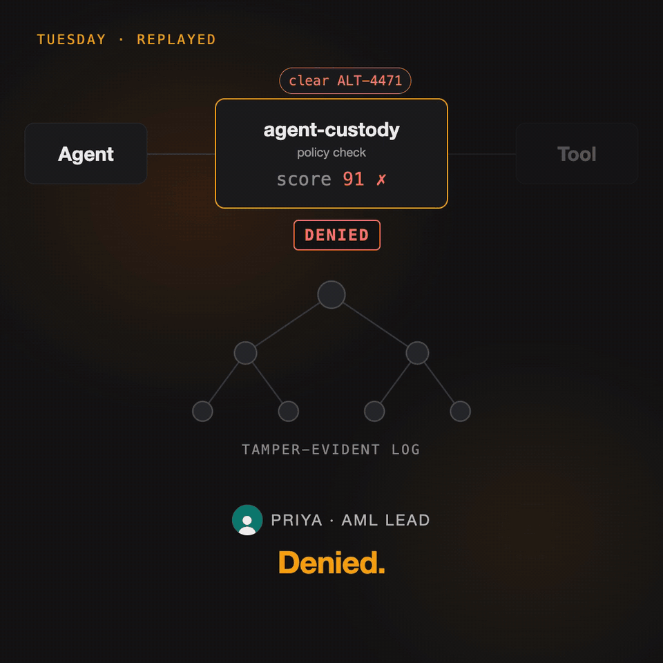

# agent-custody

[](https://github.com/svayatta/agent-custody/actions/workflows/test.yml) [](https://github.com/svayatta/agent-custody/actions/workflows/site.yml) [](https://github.com/svayatta/agent-custody/actions/workflows/monitor.yml) [](https://www.npmjs.com/package/@agent-custody/receipts) [](https://pypi.org/project/agent-custody/)

**Proof of what your AI agents did.**

Give your agents real power, without losing control of them. Your policy checks your agent's actions before they run. What it forbids does not run. Each action that it checks leaves a signed receipt that anyone can verify.

[](https://agent-custody.dev/advanced#product-overview-film)

*An agent cleared an alert, and its own log was the only record. Replayed through agent-custody, the call is denied, and an auditor can prove it. [Watch the 30-second film with sound](https://agent-custody.dev/advanced#product-overview-film).*

agent-custody is infrastructure to authorize the actions of AI agents and to account for them:

- **A gateway** between your agents and their tools: MCP servers, REST APIs, and other agents over A2A. A person signs a grant that names the agent, its tools, and how long it may act.
- **Cedar or Rego policy** decides each call before the tool runs. The policy reads facts that the gateway looks up itself, not what the agent claims.
- **Signed receipts and a Merkle transparency log.** Each call gets a receipt, allowed or denied. A rewrite of the log is detectable.
- **Offline verification.** An auditor or a counterparty checks a receipt with public keys only.
- **Governed memory.** Each belief of an agent cites the receipt that produced it, and a wrong belief can be traced and retracted.
- **Integrations:** Claude Code, the Claude Agent SDK, the OpenAI Agents SDK, the Vercel AI SDK, LangChain, CrewAI, Google ADK, and clients in Python, Go, Java, and Rust.

The fastest way to try it is [the Claude Code hook](#start-with-a-coding-agent): one command. Before you rely on any part, read [the threat model](packages/receipts/docs/threat-model.md). It lists what each part defends, and what it does not.

## How it works

```text
                     your policy  (+ a grant that a person signs, at the gateway)
                          │
agent ── action ──► hook or gateway ── allowed ──► tool: shell, database, payments API, MCP server
                          │
                          └── allowed or refused ──► signed receipt ──► log ──► verifier (public keys only)
```

1. You write the policy: what the agent may do. At the gateway, a person also signs a grant. The grant names the agent, its tools, and how long it may act.
2. Before an action runs, the hook or the gateway checks it against the policy. An action that the policy forbids does not run.
3. Each action that it checks gets a signed receipt, allowed or refused. The receipt goes into an append-only log.
4. A reviewer, an auditor, or a counterparty verifies the receipt offline, with public keys only. They need no access to your systems.

There are two ways to start:

| | Agents that move money | Coding agents |
| --- | --- | --- |
| What runs | a gateway between the agent and its tools | a hook inside Claude Code |
| Try it | `bun run demo` | `agent-custody init claude-code` |
| What it stops in the example | a refund over the limit, a refund to an unverified customer, a payout outside the grant | force push, `rm -rf` on `/` and `~`, `terraform destroy`, `drop database` |
| Read on | [Agents that move money](#agents-that-move-money) | [Start with a coding agent](#start-with-a-coding-agent) |

## Agents that move money

A support agent issues refunds through the gateway, against a test Stripe server. A person signed the agent's grant. The policy reads facts that the gateway looks up itself, not what the agent claims.

```bash
git clone https://github.com/svayatta/agent-custody
cd agent-custody && bun install && bun run demo
```

- A £500 refund to a verified customer runs.
- A £5,000 refund is refused: it is over the policy limit.
- A £500 refund to an unverified customer is refused. The gateway looked up the customer itself.
- A payout is refused: the tool is not in the grant.
- An auditor verifies all four receipts with public keys and a copy of the log. Then someone edits the first receipt to make the refund look smaller, and the verification fails.

The demo needs Node 22 and Bun. The [refund demo](site/advanced.md#the-refund-demo) shows the output step by step. For production payments, read [safe financial operations](packages/receipts/docs/financial-operations.md) (budgets, idempotency, and reconciliation with the provider), [human approvals](packages/receipts/docs/approvals.md) (one or two people approve the exact payment), and [completeness](packages/receipts/docs/completeness.md) (the provider's records matched against the receipts, so an action that went around the gateway shows up).

The gateway covers only the calls that go through it. A credential in the agent's own environment goes around it: [the egress witness](#calls-that-go-around-the-gateway-the-egress-witness) and lockdown close that route. The [threat model](packages/receipts/docs/threat-model.md) lists the other limits.

## Start with a coding agent

This is for engineers who run Claude Code against repositories and systems that touch production. One command adds a hook to Claude Code. The hook checks each shell command, file edit, and MCP tool call against a deny list before the call runs. The starter list covers force push, `rm -rf` on `/` and `~`, `terraform destroy`, and `drop database`.

```bash
npm install -g @agent-custody/receipts
agent-custody init claude-code
```

The command needs Node 22. To try it once, run `npx @agent-custody/receipts init claude-code`. Do not keep the npx form: npm can clear its cache, and the hooks then stop working. The command makes an agent key, writes a starter deny list, and registers the hooks in `.claude/settings.local.json` of the current directory. It starts in observe mode: it blocks nothing until you say so. Details and options: [Setup for Claude Code](site/guide/getting-started.md#claude-code-in-one-command).

### What you see

Work in Claude Code as usual. The hook signs a record of each shell command, file edit, and MCP tool call. The record is called a receipt. Then run the report. It checks the signature of every receipt, and it lists the calls that the deny list would have stopped.

```bash
agent-custody report --config ~/.config/agent-custody/sdk.json
```

```text
would have denied 2 calls (the policy recorded each one and blocked nothing)

  Bash: git push --force origin main
    reason:  force push rewrites shared history (git push --force-with-lease is allowed)
    rule:    forbid(principal, action == Action::"Bash", resource) when { context.args has command && ( context.args.command like "*git push*--force *" || context.args.command like "*git push*--force" || context.args.command like "*git push -f*" || context.args.command like "*git push* -f" ) } [policy1]
    receipt: 191e1095-db76-45fc-82d4-3dc9a6e14023  (2026-11-02T11:15:18.824Z)

  Bash: terraform destroy -auto-approve
    reason:  terraform destroy deletes infrastructure
    rule:    forbid(principal, action == Action::"Bash", resource) when { context.args has command && context.args.command like "*terraform destroy*" } [policy5]
    receipt: 6f4c2455-b578-4a0f-b7ed-7fee177e5a9b  (2026-11-02T11:15:18.827Z)

Checked 4 receipts: 4 verified, 0 did not verify.

To enforce this policy, remove the "mode": "observe" line from ~/.config/agent-custody/sdk.json. A denied call is then blocked before it runs.
```

That output comes from [tutorial 36](packages/receipts/examples/36-claude-code-init.ts), with the path of `sdk.json` shortened. To enforce the list, remove the `"mode": "observe"` line. A denied call then stops before it runs.

### An incident replay

A coding agent runs `terraform destroy`. A script plays the session in enforce mode. It needs no model and no network, and it runs no destructive command.

```bash
git clone https://github.com/svayatta/agent-custody
cd agent-custody && bun install
cd packages/receipts && node examples/38-incident-replay.ts
```

- `terraform plan` runs. The hook records an executed receipt.
- `terraform destroy -auto-approve` is denied before it runs. Claude Code shows the agent `agent-custody denied this call: terraform destroy deletes infrastructure (rule policy5, receipt 980d078f-2922-42b7-a5de-de3b99b00997)`.
- `rm -rf ~` is denied the same way.
- A reviewer holds the agent's public key and the receipt files. They verify the three receipts offline. The same check with a key that is not the agent's fails for the `terraform destroy` receipt.

The full output is on the page [An incident replay](site/guide/incident-replay.md).

### What the hook does not stop

The hook stops a shell command, a file edit, or an MCP tool call that the agent makes. Read these limits before you rely on it.

- **A credential in the agent's environment goes around the hook.** If the shell of the agent holds a cloud key or a database password, a process that the agent starts can use it. The hook does not stop that process.
- **The starter list matches the text of a command.** It catches the plain form of each command. It is not a sandbox.
- **Some tools are not seen.** The hook matches `Bash`, `Write`, `Edit`, `MultiEdit`, `NotebookEdit`, and MCP tools. It does not see `Read`, `Grep`, `Glob`, `WebFetch`, `WebSearch`, or `Task`. The starter deny list has rules for `Bash` only.
- **The record is the agent's own report.** Every field is `claimed`. The signature shows that the record did not change after the hook wrote it. It does not show that the hook saw every call.

To cover more, keep production credentials out of the agent's environment, and put a gateway between the agent and the tools that touch production. The [threat model](packages/receipts/docs/threat-model.md) lists what each part defends, and what it does not. No independent witness runs yet, and the hosted log is not anchored on mainnet yet.

## Calls that go around the gateway: the egress witness

The gateway receipts the calls that go through it. An agent that holds a credential of its own, or can reach the internet directly, can call a provider around it. The egress witness closes that route. It is a forward proxy in the agent's network path, and lockdown makes it the agent's only way out other than the gateway.


1. **Lockdown.** The agent's pod or container gets default-deny egress. It can reach only the gateway, the witness, and DNS.
2. **Credential custody.** Tool credentials live only in the gateway. Calls that need a credential go there and are receipted as before.
3. **The witness.** Everything else must go through `agent-custody egress`, set as the agent's `HTTPS_PROXY`:
   - it identifies the agent by that agent's own proxy credential;
   - a Cedar policy decides per destination (`host:port`);
   - it commits the connection to the log before any byte moves;
   - it relays or refuses the connection, and signs a receipt either way.

| case | what happens | receipt |
| --- | --- | --- |
| a tool call through the gateway | the gateway decides it on its arguments | the gateway's, as before |
| a direct call to a provider, such as `CONNECT api.stripe.com:443` | refused with 403; nothing is opened | `denied` |
| a host the policy permits | relayed as an opaque tunnel | `executed`: destination, address, times, bytes each way |
| no valid proxy credential | refused with 407, whatever the destination | `denied`, agent `unknown` |
| an agent that ignores the proxy | dropped by the network policy | none: the witness never sees it |

**What it cannot see.**
- Payloads: there is no TLS interception, so a receipt records where traffic went, not what was sent.
- Traffic when lockdown is off: an agent can simply ignore `HTTPS_PROXY`.
- Protocols other than HTTP.

Each receipt is an observed bypass, not a record of what was done. A permitted host name is never dialled at an internal address such as the cloud metadata service.

**Where it runs.** The witness runs anywhere Node 22 runs. Lockdown depends on the platform: `deploy/gateway/lockdown` ships it for Kubernetes (a NetworkPolicy), docker compose (an internal network), and a Linux VM or bare metal (an nftables rule on the agent's user and a systemd drop-in). On a cloud task, build the same default-deny egress with that platform's firewall. [Credential custody and lockdown](site/guide/credential-custody.md) shows how. [The egress witness](packages/receipts/docs/egress.md) has the config, the policy, and the receipt. Tutorial 41 runs it end to end.

## Advanced

The sections above are the two ways to start. The rest of the product is below and on the [advanced page](site/advanced.md): the gateway with grants and Cedar policy, the transparency log, the state package for agent memory, the hosted log, and the other frameworks and languages.

### What each piece is for, and when you need it

<!-- #region pieces -->
Each part exists because a specific thing goes wrong without it. Use the table to decide what to turn on.

| piece | the failure it prevents | you need it when |
| --- | --- | --- |
| **SDK interceptor** (`@agent-custody/receipts`, in the agent's process) | The only record of what an agent did is its own log: mutable, unsigned, written by the thing you are trying to check. | Any agent that calls tools. Turn it on first; it is a hook or a wrapped function. It is honest about being self-reported: every field is labelled `claimed`. |
| **Gateway** (`@agent-custody/receipts`, a separate process between agent and tools: MCP servers, REST APIs described as tools, or other agents reached over A2A) | An in-process hook can be skipped, and a policy that reads the agent's own arguments can be fed lies. | The call moves money, touches production, or handles personal data, or a security owner has to sign off on what agents may do. Denied calls never reach the tool and still produce a receipt. For tools named in `precommit`, the gateway logs a signed authorization before forwarding and withholds the call if the log will not take it, so the evidence exists before the side effect does. Only calls through the gateway are covered; a credential in the agent's own environment bypasses it. |
| **Door** (`agent-custody door`, a reverse proxy in front of your own website, API, or forms) | Visitors to your own site, browsers, API clients, crawlers, and agents, act on it with nothing signed to say who they were, what they presented, or why they were let in. | Agents or other automated clients reach your site or API, and you have to show what each one presented and what your policy decided. Each arrival is `verified` (a grant from a principal you trust), `claimed` (an assertion the door cannot check), or `unknown`; a Cedar policy per route decides; the door relays or refuses, and receipts the arrival either way. It can also record the pace of arrivals and send a person through Turnstile or hCaptcha. It does not yet detect agents in web traffic. |
| **Egress witness** (`agent-custody egress`, a forward proxy, with egress lockdown in `deploy/gateway/lockdown`) | An agent with a credential of its own calls the provider directly, and the gateway never sees the call. | You need to show that agents did not go around the gateway, or to refuse it when they try. Under lockdown, the agent's network reaches only the gateway and the witness. The witness identifies the agent by its proxy credential, lets a Cedar or Rego policy decide per destination, and receipts each connection, relayed or refused. It records the destination and the byte counts, never the payload: there is no TLS interception. It sees nothing when lockdown is off, and it relays no protocol other than HTTP. Each receipt is an observed bypass, not a record of what was done. |
| **Delegation grant and Cedar policy** (used by the gateway) | "The agent was allowed to do that" is a comment in a config file, not something a human signed. | Always with the gateway. The grant is signed by the principal and names agent, tools, and validity window; the policy decides on facts the gateway fetched itself, never on the agent's claims. |
| **Transparency log** (local file, automatic) | A signed receipt can be deleted or replaced after the fact and nobody would know. | Always; every receipt is a leaf with an inclusion proof. Costs nothing to use. |
| **Remote log** (`log` in the config, plus the `log` command or a hosted log) | The operator holds the local log file and can rewrite history in it. | A receipt will be shown to someone who does not trust the operator: an auditor, a counterparty, a customer, a regulator. The log's key, not yours, signs the tree heads. |
| **Verifier** (`verify` and `audit` commands, or `verifyBundle`) | Trust that depends on access to the system that produced the record is not trust. | Whenever a receipt leaves the team that made it: an audit, a CI gate, acceptance by the other side of an agent-to-agent call. It needs public keys and nothing else. On a pull request, the GitHub Action in this repository runs it and posts the result as a comment. |
| **State ledger** (`@agent-custody/state`) | Agents act on beliefs. A wrong belief spreads to other agents, cannot be traced to its source, and is overwritten rather than corrected, so "what did it believe on Tuesday" has no answer. | The agent remembers across sessions, shares memory with other agents, or takes actions whose justification you may later have to explain or undo. Every belief cites the receipt that produced it, is superseded rather than overwritten, and is retracted rather than deleted. |
| **Quarantine and provenance levels** (the memory server) | A self-reported write, or a value copied from an untrusted tool result, becomes something the whole fleet believes. | Any agent writes memory without going through the gateway, or writes values it got from tools. Claimed facts stay hidden until an attested party confirms them; a write can cite what the gateway itself fetched and is then verified, or refused. |
| **Blast radius** (`blast`) | A belief turns out wrong and nobody can say which actions were taken on it or which later beliefs came from it. | Before any cleanup after a bad write. Every receipt records what the agent had been shown; the query walks forward to every call and derived belief, with the retraction status. |
| **The review page** (`agent-custody-memory review`) | The security officer or counsel who has to read the evidence will not open a terminal, and a screenshot of one is not a review. | Any review by a non-engineer. The explain output as pages over your own receipts and ledger, with a verdict per receipt and the receipt to download, served on loopback or written as files for a case file. |
| **Explain one action** (`agent-custody-memory explain`) | An incident review starts from a refund id and a pile of logs, and the reviewer reconstructs who, why, and what else by hand. | Any time someone asks "what is this action and can I trust the answer". From a receipt id: who acted, who authorized it, what was allowed, what the agent saw, what it did, why, the evidence, whether it verifies, what depended on it, and what needs reversal, as text or as one signed pack with every receipt inside. |
| **Certified forget, retention, legal hold** (the memory server) | A deletion demand is answered with "we think it's gone". Retention is a policy document, not something that runs. A hold is an email. | Personal data in memory, a regulator or customer with a deletion right, or a matter under litigation. Forget erases the value from the ledger and every store, checks each store's search that it is really gone, and the receipt is the certificate; sweeps run retention as receipted calls; a hold refuses both until released; `pack` hands counsel the whole story of a fact as one signed artefact. Forget reaches the ledger and the adapted stores and records what each answered; caches, model context, backups, and warehouses are outside it. |
| **Write-through to Mem0 and Zep** | The team already runs a retrieval store, and governing memory would mean replacing it. | Any existing Mem0 or Zep deployment. The ledger sits under it: writes land in the store with custody metadata, retractions and forgets reach it, and recall stays where it was. |
| **Eval harness** | "Our memory is governed" is a claim with no number behind it. | Before a design review or a vendor comparison. Scripted incidents score stale reads, contradictions, and blast radius for this ledger and for any store behind the same interface. |

The rule of thumb: record everything with the SDK, enforce the consequential calls with the gateway, log remotely once a receipt has an audience outside the team, put beliefs in the ledger the moment memory outlives a session, and turn on quarantine, forget, and holds the moment that memory holds anything about a person.
<!-- #endregion pieces -->

### The SDK and the state ledger, step by step

<!-- #region getting-started -->

Node 22 or later. Both packages ship compiled JavaScript with type declarations.

```bash
npm install @agent-custody/receipts @agent-custody/state
```

**1. Give the agent's process a signing key and a config.** The key signs every receipt. The config says where receipts and the log go.

```bash
npx @agent-custody/receipts keygen --dir keys --name app
```

```json
{ "agentId": "support-bot", "identity": { "keyFile": "keys/app.key" }, "receiptsDir": "receipts", "logFile": "log.jsonl" }
```

**2. Record a tool call as a receipt.** Wrap the functions the agent calls, or record a call explicitly. Either way a signed receipt lands in `receipts/` and a leaf in the Merkle log.

```ts
import { createSdkIssuer, loadSdkConfig } from "@agent-custody/receipts";

const issuer = createSdkIssuer(loadSdkConfig("./sdk.json"));

const lookup = issuer.wrap("crm.lookup", async (args: { id: string }) => crm.lookup(args));   // records every call
const customer = await lookup({ id: "acct:42" });

const bundle = await issuer.record({ tool: "crm.lookup", args: { id: "acct:42" } }, { status: "executed", result: customer });   // or record one by hand and keep the bundle
```

**3. Verify it, offline.** Anyone with the public key and a copy of the log can check the signature, the statement, and the inclusion proof. No access to the agent or the issuer needed.

```ts
import { loadPublicKey, verifyBundle } from "@agent-custody/receipts";

verifyBundle(bundle, { issuerKeys: [loadPublicKey("keys/app.pub")], principalKeys: [], logFile: "log.jsonl" }).ok;   // true
```

```bash
npx @agent-custody/receipts verify receipts/<id>.json --issuer-key keys/app.pub --log log.jsonl    # the same check from the shell
```

**4. Record what the agent now believes, citing the receipt.** The ledger is bitemporal: it knows when a fact was true and when the agent learned it. A belief points back at the receipt that produced it.

```ts
import { receiptIdOf } from "@agent-custody/receipts";
import { Ledger } from "@agent-custody/state";

const ledger = new Ledger("./ledger.jsonl"); // or "./ledger.sqlite", or "postgres://…"
const belief = await ledger.assert({ subject: "acct:42", predicate: "plan", value: customer.plan, space: "org", actor: "support-bot", source: { receiptId: receiptIdOf(bundle) } });
```

**5. When a belief is wrong, undo it without losing the record.** Retract removes it from the present, keeps it visible to questions about the past, and restores whatever it had superseded. The receipt id says exactly which call produced the bad belief.

```ts
await ledger.retract({ factId: belief.fact.factId, actor: "user:admin", reason: "CRM lookup returned a stale plan" });
await ledger.asOf({ subject: "acct:42" });                                                  // [] now
await ledger.asOf({ subject: "acct:42", validAt: earlier, txAt: earlier });                  // still shows what was believed then
await ledger.history(belief.fact.factId);                                                    // assert, retract, with actors and reasons
```

This whole loop is one runnable file, [packages/state/examples/02-receipt-to-belief.ts](packages/state/examples/02-receipt-to-belief.ts), executed by the test suite.
<!-- #endregion getting-started -->

**Where to go next**

- Enforce instead of record: put the gateway between the agent and its MCP tools, its REST APIs, or any agent it delegates to over A2A, with a signed delegation grant and a Cedar policy. Denied calls never reach the tool and still get a receipt. [packages/receipts/docs/usage.md](packages/receipts/docs/usage.md)
- Hook an existing framework: Claude Code and the Claude Agent SDK, the OpenAI Agents SDK, the Vercel AI SDK, LangChain, OpenClaw, DeepSeek Harness; in Python also CrewAI, Google ADK, and Hermes Agent. [packages/receipts/docs/sdk.md](packages/receipts/docs/sdk.md)
- Write policies, for tools and for memory, with tested examples, and read what a verified receipt does and does not prove. [policies.md](packages/receipts/docs/policies.md), [verification.md](packages/receipts/docs/verification.md)
- Answer a security questionnaire with a file: which artefact supplies evidence for which SOC 2, ISO 27001, UK GDPR, EU AI Act, FINRA, MAS, Colorado, DORA, CSA AICM, OWASP, and ISO 42001 requirement, with dates, primary sources, and what a receipt does not supply. [compliance.md](packages/receipts/docs/compliance.md)
- Give a security reviewer the attacker's view: who could make a receipt false, what stops them, and what is not defended. [threat-model.md](packages/receipts/docs/threat-model.md)
- Log to a server the operator does not control, so tree heads are signed by a key that is not yours. [verification.md](packages/receipts/docs/verification.md)
- Verify a receipt in the browser, nothing uploaded, and check a second implementation against the published conformance vectors. [agent-custody.dev/verify](https://agent-custody.dev/verify), [vectors](https://agent-custody.dev/receipt/vectors)
- Prove a log was never rewritten: keep any receipt's tree head, later audit that the log still extends it. [verification.md](packages/receipts/docs/verification.md)
- Run the console for a gateway: config, tools, receipts with a verdict each, a policy editor that replays recorded calls before it saves, and grant revocation, as a service of its own. [console.md](packages/receipts/docs/console.md).
- Configure the gateway: who may use which tools, where the tools live, a worked example, and `agent-custody check` to validate a config before it starts. [configuration.md](packages/receipts/docs/configuration.md).
- Run one shared gateway for every agent on a host or cluster: a container image for amd64 and arm64, compose, Kubernetes, and systemd recipes, a starter config, and egress lockdown manifests for the agents (`deploy/gateway/lockdown`, [credential custody and lockdown](site/guide/credential-custody.md)). [deploy/gateway](deploy/gateway/README.md).
- See how it fits together, with diagrams: what runs on the customer's side, what is hosted, the sequence of a call, onboarding, revocation, and verification. [Architecture](site/guide/architecture.md).
- Where each piece runs, sized, with what interception does not reach. [Deployment](https://agent-custody.dev/guide/deployment). What each release changed: [changelog](CHANGELOG.md).
- Register a tenant on the hosted log at [app.agent-custody.dev](https://app.agent-custody.dev/#register) and get a log and a first key at once: free for ten thousand appends a month, [$50 a month](https://agent-custody.dev/pricing) for a million, a dashboard with usage against the plan, keys, and every action taken on the tenant, and an export that takes everything with you.
- The reference at [docs.agent-custody.dev](https://docs.agent-custody.dev/): every feature, and the exact request and response of every function, endpoint, MCP tool, and command.
- Want a log run by someone who is not you? [deploy/](deploy/README.md) has the container, a docker compose file for one VM, and Kubernetes manifests to run it on a machine the operator does not control; or take a tenant on the one we run, at [log.agent-custody.dev](https://agent-custody.dev/early-access), on the [Free or Team plan](https://agent-custody.dev/pricing).
- Agents in Python, Go, Java, Rust, or anything else: the gateway is an MCP server and needs nothing from your language; for in-process receipts run the sidecar and use the Python package or a forty-line client. [sdk.md](packages/receipts/docs/sdk.md#other-languages-the-sidecar)
- Step-by-step examples in the receipts package and more in the state package: [receipts tutorials](packages/receipts/docs/tutorials.md), [state examples](packages/state/examples).

## Packages

| package | what it is | status |
| --- | --- | --- |
| [`@agent-custody/receipts`](packages/receipts/README.md) | Signed receipts for tool calls: an MCP gateway with Cedar or Rego policy (a file, or your OPA server) and a Merkle transparency log, an in-process SDK with framework adapters, [the door](packages/receipts/docs/door.md) in front of your own site or API, [the egress witness](packages/receipts/docs/egress.md) for calls that go around the gateway, and an offline verifier, also as [a GitHub Action](packages/receipts/docs/github-action.md) on pull requests ([on the Marketplace](https://github.com/marketplace/actions/agent-custody-receipts)) | working, with runnable tutorials |
| [`agent-custody` on PyPI](packages/python/README.md) | The Python client of the sidecar: `decide`, `record`, `wrap`, and adapters for LangChain, the OpenAI Agents SDK, the Claude Agent SDK, CrewAI, Google ADK, and a Hermes Agent plugin, tested against the real packages | working; Go, Java, and Rust clients live in [examples/languages](packages/receipts/examples/languages) |
| [`@agent-custody/state`](packages/state/README.md) | Governed memory: a fact ledger where every write cites the receipt that caused it, carries valid time and transaction time, and can be superseded or rolled back | ledger on JSONL, SQLite, or Postgres, memory server behind the gateway or shared over HTTP, quarantine and verified provenance, blast radius, certified forget, retention and legal holds, write-through to Mem0 and Zep, eval CLI with signed reports |

Receipts are the unit. State is the ledger of what the agent came to believe from them. Both append to the same kind of signed log and are checked by the same kind of verifier.

Try the [live Codex recovery demo](packages/receipts/docs/codex-recovery.md): a real agent handles a support request using incorrect customer memory, then an operator traces possible consequences, approves corrections and simulated credit compensation, and verifies the evidence.

## Agent sessions in this repository

A Claude Code session in this repository can run under custody. On a machine with the recording config, each shell command, file edit, and MCP tool call becomes a signed receipt, and its hash goes to our tenant on the hosted log within seconds. A force push is refused by policy, and the refusal is a receipt too. A machine without that config records and refuses nothing, so the tenant does not cover all the work in this repository. The hook is committed in `.claude/`, the receipts and keys stay outside the repository, and [agent-custody.dev/custody](https://agent-custody.dev/custody) shows the live tenant and sample receipts anyone can verify.

## Security

Report a vulnerability privately to partha@charioteerconsulting.com; [SECURITY.md](SECURITY.md) has the scope, the response times, and how keys and tokens are protected.

The [threat model](packages/receipts/docs/threat-model.md) lists what each part defends, and what it does not. The limits of the Claude Code hook are in [What the hook does not stop](#what-the-hook-does-not-stop).

## Working in the repository

```bash
bun install                         # one install for the whole workspace
bun run test                        # every package
bun run build                       # dist/ for every package, what consumers install
bun run test:python                 # the Python package, with uv; needs node for the sidecar
bun run ci                          # everything the GitHub workflow runs; the pre-push hook runs it before any push to main
bun run demo                        # the receipts demo: keys, grant, policy, tool calls, verification, a tampering attempt
```

The source runs on plain Node 22 or later with no build step. `bun run build` makes the `dist/` that consumers install. Package-level commands, such as the CLI and the tutorials, run from inside that package's directory; each package README says how. [CONTRIBUTING.md](CONTRIBUTING.md) has the rules for a change, a release, and a publish.

## Layout

```
package.json          workspace root: typecheck, test, and demo across packages
tsconfig.base.json    compiler options shared by every package
action.yml            the GitHub Action that verifies receipts on a pull request (packages/receipts/docs/github-action.md)
packages/receipts/    the receipts package: src, test, examples, scripts, docs
packages/python/      the Python client package: agent_custody, tests run with uv against a real sidecar
packages/state/       the state package: src, test, examples
deploy/               containers for the log, the witness, and the gateway: compose files, Kubernetes manifests, and the runbook
site/                 the website, generated from this repository's markdown by VitePress
spec/lean/            a Lean 4 model of the verifier's core with machine-checked proofs and a differential fuzzer; not shipped
```

## Plan

The receipts package's roadmap is in [its README](packages/receipts/README.md#plan). The state package has the ledger on JSONL, SQLite, or Postgres with every query answered from an index, the memory server behind the gateway and shared over HTTP, quarantine with three provenance levels and value-level evidence, policy over the fact being changed, consumed facts and blast radius, certified forget with keyed digests and verified removal from stores, retention sweeps and legal holds, the custody pack for counsel, write-through to Mem0 and Zep, and the eval CLI with signed reports; its remaining item is the hosted plane, tracked as an issue in [its README](packages/state/README.md#plan).
