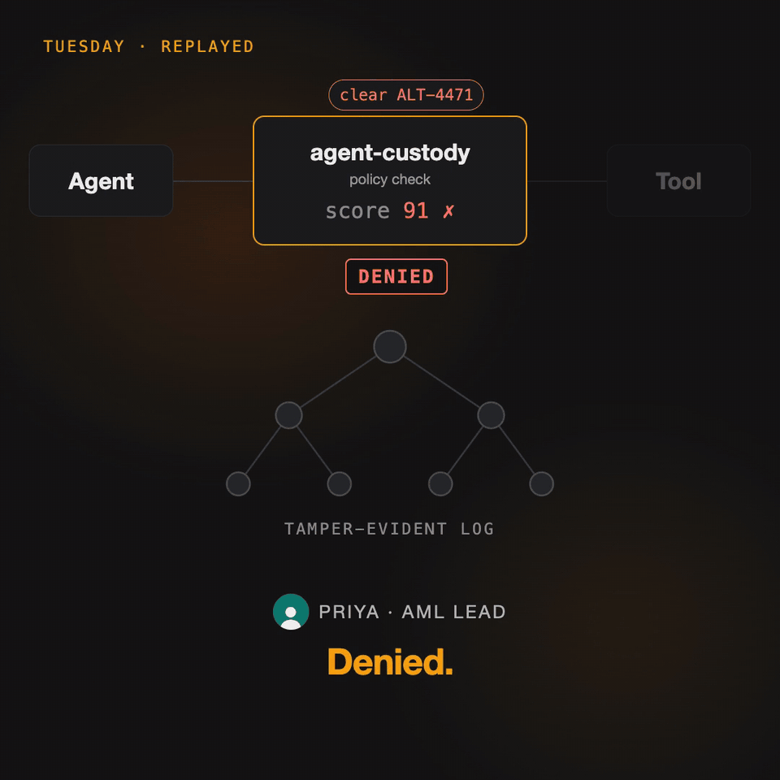

# agent-custody

[](https://github.com/svayatta/agent-custody/actions/workflows/test.yml) [](https://github.com/svayatta/agent-custody/actions/workflows/site.yml) [](https://github.com/svayatta/agent-custody/actions/workflows/monitor.yml) [](https://www.npmjs.com/package/@agent-custody/receipts) [](https://pypi.org/project/agent-custody/)

**Proof of what your AI agents did.**

Give your agents real power, without losing control of them. Your policy checks your agent's actions before they run. What it forbids does not run. Each action that it checks leaves a signed receipt that anyone can verify.

[](https://agent-custody.dev/how-it-works#product-overview-film)

*An agent cleared an alert, and its own log was the only record. Replayed through agent-custody, the call is denied, and an auditor can prove it. [Watch the 30-second film with sound](https://agent-custody.dev/how-it-works#product-overview-film).*

agent-custody is infrastructure to authorize the actions of AI agents and to account for them. A **gateway** sits between your agents and their tools: MCP servers, REST APIs, and other agents over A2A. A person signs a grant that names the agent, its tools, and how long it may act, and a **Cedar or Rego policy** decides each call before the tool runs, on facts that the gateway looks up itself. Each call, allowed or denied, gets a **signed receipt** in a **Merkle transparency log**, and an auditor verifies it **offline**, with public keys only. A hook brings the same check to Claude Code, and **governed memory** ties each belief of an agent to the receipt that produced it.

**Do you run a website or an API?** The **door** does the same job in front of your own site: [put the door in front of a site](packages/receipts/docs/door-quickstart.md) in about fifteen minutes, with Docker and `curl` only.

Before you rely on any part, read [the threat model](packages/receipts/docs/threat-model.md). It lists what each part defends, and what it does not.

## Getting started

**Prerequisites.** Node 22 or later and Bun 1.3 (CI pins 1.3.2). For the Python package, uv with Python 3.10 or later. For the gateway container, Docker. Go, Java, Rust, and Ruby are optional, for the language examples; the tests skip a language whose toolchain is missing.

### Try it

```bash
git clone https://github.com/svayatta/agent-custody && cd agent-custody
```

```bash
bun install
```

```bash
bun run build
```

```bash
bun run demo
```

`bun run build` writes each package's `dist/`; the state package imports receipts from there. The demo sends a support agent's refunds through a real gateway to a stand-in Stripe server. A £500 refund to a verified customer runs; a refund over the limit, a refund to an unverified customer, and a payout outside the grant are refused. An auditor verifies all four receipts with public keys, and a receipt edited afterwards fails. [The refund demo](site/how-it-works.md#the-refund-demo) walks through the output.

`bun run demo:refund` runs Demo 1, the refund, on both halves. A shop has the door in front of its refund API and pays through the gateway. A shopping agent with a passport is paid once, even when it retries. Over the limit, or with a forged passport, it is refused at the door. An agent with no passport waits until a person approves that exact refund. An auditor with public keys and a read-only view of Stripe verifies every receipt and finds a refund made in Stripe directly. It needs no key and no network. [Tutorial 59](packages/receipts/examples/59-refund-demo.ts) is the source.

`bun run demo:admitted` runs Demo 3, agent admitted. A marketplace has the door in front of its order API and admits only the agents on its partners list. An agent-commerce company's agent, sending only its signature, is blocked. The company registers the agent at the registry and gets a passport. The door then knows who the agent is and who owns it, and still blocks it, because the marketplace has not listed it. The marketplace finds the agent by searching the registry for a capability and lists it, and the next order goes through. The merchant then verifies every receipt with the door's public key and reads who each agent was, who owns it, and what it did. It needs no key and no network. [Tutorial 65](packages/receipts/examples/65-agent-admitted-demo.ts) is the source.

### Use the packages

```bash
npm install @agent-custody/receipts @agent-custody/state
```

```bash
pip install agent-custody
```

The APIs are in each package's README: [receipts](packages/receipts/README.md), [state](packages/state/README.md), and [Python](packages/python/README.md), a client of the sidecar (`agent-custody serve --config sdk.json`). [Getting started on the site](site/guide/getting-started.md) has every framework and the whole loop from receipt to belief in one file.

### Run the gateway

**In a container.** From `deploy/gateway`, copy `.env.example` to `.env` and set `AGENT_CUSTODY_GATEWAY_VERSION` to a release version; there is no default. Then write a starter config, edit its upstream, and start the gateway on `127.0.0.1:8790`. Delete `config/demo/` before production. [deploy/gateway](deploy/gateway/README.md) has the image, its signature, Kubernetes, systemd, and egress lockdown.

```bash
mkdir config && sudo chown 10001:10001 config && docker compose --profile init run --rm init
```

```bash
docker compose up -d
```

**From source.** At the repository root, after `bun install`, point an alias at the CLI (with the package installed globally, `agent-custody` is already the command). Then, in an empty directory, make the gateway's key and a principal's key, and sign a grant. In production the principal's private key stays on the principal's own machine.

```bash
alias agent-custody="node $PWD/packages/receipts/src/cli.ts"
```

```bash
agent-custody keygen --dir keys --name gateway && agent-custody keygen --dir keys --name principal
```

```bash
agent-custody grant --key keys/principal.key --principal ops-lead --agent support-agent --scopes orders.refund --ttl-hours 8 --out grant.json
```

Write `policy.cedar` ([writing policies](packages/receipts/docs/policies.md)) and `gateway.json`, here with one REST tool whose credential comes from the environment ([configuring the gateway](packages/receipts/docs/configuration.md)):

```cedar
permit(principal, action == Action::"orders.refund", resource) when { context.args.amount <= 100000 };
```

```json
{
  "identity": { "keyFile": "keys/gateway.key" },
  "upstream": { "rest": { "baseUrl": "https://api.example.com", "headerEnv": { "authorization": "APP_API_AUTHORIZATION" }, "tools": [{
    "name": "orders.refund", "method": "POST", "path": "/v1/orders/{order_id}/refund",
    "inputSchema": { "type": "object", "properties": { "order_id": { "type": "string" }, "amount": { "type": "integer" } }, "required": ["order_id", "amount"] } }] } },
  "grantFile": "grant.json", "trustedPrincipalKeys": ["keys/principal.pub"], "policyFile": "policy.cedar",
  "receiptsDir": "receipts", "logFile": "log.jsonl"
}
```

Set `APP_API_AUTHORIZATION` in the environment, check the config, and run the gateway: on stdio, for an MCP host to spawn, or with `--http` as one shared gateway at `http://127.0.0.1:8790/mcp`, where each agent presents its own grant.

```bash
agent-custody check --config gateway.json --connect
```

```bash
agent-custody gateway --config gateway.json --http
```

### Coding agents

See what the starter deny list would have caught in your last week of Claude Code; this reads local transcripts and writes nothing. Then install the hook, which starts in observe mode and blocks nothing until you say so. [Claude Code](packages/receipts/docs/sdk.md#claude-code) has the options, the report, and [what the hook does not stop](packages/receipts/docs/sdk.md#what-the-hook-does-not-stop).

```bash
npx -y @agent-custody/receipts audit-sessions --since 7d
```

```bash
npm install -g @agent-custody/receipts && agent-custody init claude-code
```

### Develop

`bun run test` and `bun run typecheck` run across the packages. The gate before anything goes to main is `bun run ci`, with uv pinned to the Python that CI uses. The Python tests run on their own with uv, after `bun run build`. [Working in the repository](CONTRIBUTING.md#working-in-the-repository) has the rest.

```bash
UV_PYTHON=3.12 bun run ci
```

```bash
cd packages/python && uv run --extra test pytest -q
```

```bash
bun run site:dev
```

## Documentation

**Concepts**
- [How it works](site/how-it-works.md): the film, the problem, the refund demo, the flow, policies, and receipts compared with logs and traces.
- [Components](site/guide/pieces.md): each component, the failure it prevents, and when you need it.
- [Architecture](site/guide/architecture.md) and [deployment](site/guide/deployment.md): what runs where, sized, and what interception does not reach.
- [Threat model](packages/receipts/docs/threat-model.md): who could make a receipt false, what stops them, and what is not defended.
- [What a receipt proves](packages/receipts/README.md#what-a-receipt-proves-and-what-it-does-not), the [receipt specification](site/receipt/v0.2.md), and the [glossary](site/guide/glossary.md).

**Guides**
- [Claude Code and the framework adapters](packages/receipts/docs/sdk.md), [other languages through the sidecar](packages/receipts/docs/sdk.md#other-languages-the-sidecar), [an incident replay](site/guide/incident-replay.md), and [step-by-step tutorials](packages/receipts/docs/tutorials.md).
- [The gateway](packages/receipts/docs/usage.md): grants, Cedar policy, MCP, REST, and A2A upstreams, and remote logs. [Writing policies](packages/receipts/docs/policies.md), for tools and for memory.
- Agents that move money: [safe financial operations](packages/receipts/docs/financial-operations.md), [human approvals](packages/receipts/docs/approvals.md), and [completeness](packages/receipts/docs/completeness.md) against the provider's records.
- Calls that go around the gateway: [the egress witness](packages/receipts/docs/egress.md), [credential custody and lockdown](site/guide/credential-custody.md), and [egress policies](site/guide/egress-policies.md).
- The door in front of your own site or API: [quick start](packages/receipts/docs/door-quickstart.md), [the door](packages/receipts/docs/door.md), [as a service from the gateway image, or behind nginx or Envoy](deploy/door/README.md), and [in Go, Rails, Django, and Spring](packages/receipts/docs/door-languages.md).
- Governed memory: [the state package](packages/state/README.md), its [examples](packages/state/examples), and the [live Codex recovery demo](packages/receipts/docs/codex-recovery.md).
- [Compliance](packages/receipts/docs/compliance.md): which artefact is evidence for which SOC 2, ISO 27001, EU AI Act, DORA, and other requirement.

**Reference**
- [The reference](site/reference/index.md): every function, endpoint, MCP tool, and command, with the [command line](site/reference/cli.md) on its own page.
- [Configuring the gateway](packages/receipts/docs/configuration.md) and [the gateway console](packages/receipts/docs/console.md).
- [Verification](packages/receipts/docs/verification.md), [verify a receipt in your browser](https://agent-custody.dev/verify), and the [conformance vectors](site/receipt/vectors.md).

**Operations**
- [The gateway as a service](deploy/gateway/README.md): the image for amd64 and arm64, compose, Kubernetes, systemd, and egress lockdown.
- [A log you do not run](deploy/README.md): the log's container, compose, and Kubernetes manifests, or a tenant on [the hosted log](site/hosted-log.md) at [app.agent-custody.dev](https://app.agent-custody.dev/#register) ([pricing](https://agent-custody.dev/pricing)).
- [The GitHub Action](packages/receipts/docs/github-action.md), on [the Marketplace](https://github.com/marketplace/actions/agent-custody-receipts): verify receipts on a pull request.
- [Status](site/status.md): what is not in place yet.

**Project**
- [Contributing](CONTRIBUTING.md): working in the repository, the layout, and the rules for a change, a release, and a publish.
- [Agent sessions in this repository](site/custody.md): this repository's own custody hook and its live tenant.
- [Roadmap](site/roadmap.md), the plans of [receipts](packages/receipts/README.md#plan) and [state](packages/state/README.md#plan), and the [changelog](CHANGELOG.md).

## Packages

| package | what it is |
| --- | --- |
| [`@agent-custody/receipts`](packages/receipts/README.md) | Signed receipts for tool calls: the gateway with Cedar or Rego policy, the Merkle transparency log, the in-process SDK with framework adapters, the door, the egress witness, an OWASP ACS Guardian (a spike), the offline verifier, and the GitHub Action |
| [`agent-custody` on PyPI](packages/python/README.md) | The Python client of the sidecar, with adapters for LangChain, the OpenAI Agents SDK, the Claude Agent SDK, CrewAI, Google ADK, and Hermes Agent; Go, Java, and Rust clients are in [examples/languages](packages/receipts/examples/languages) |
| [`@agent-custody/state`](packages/state/README.md) | Governed memory: a fact ledger where every write cites the receipt that caused it, carries valid time and transaction time, and can be superseded or rolled back |

Receipts are the unit. State is the ledger of what the agent came to believe from them. Both append to the same kind of signed log and are checked by the same kind of verifier.

## Security

Report a vulnerability privately to partha@charioteerconsulting.com; [SECURITY.md](SECURITY.md) has the scope, the response times, and how keys and tokens are protected. The [threat model](packages/receipts/docs/threat-model.md) lists what each part defends, and what it does not.

## Contributing and licence

[CONTRIBUTING.md](CONTRIBUTING.md) has the commands, the layout, and the rules for a change. Every change lands by pull request. agent-custody is licensed under [Apache-2.0](LICENSE).
