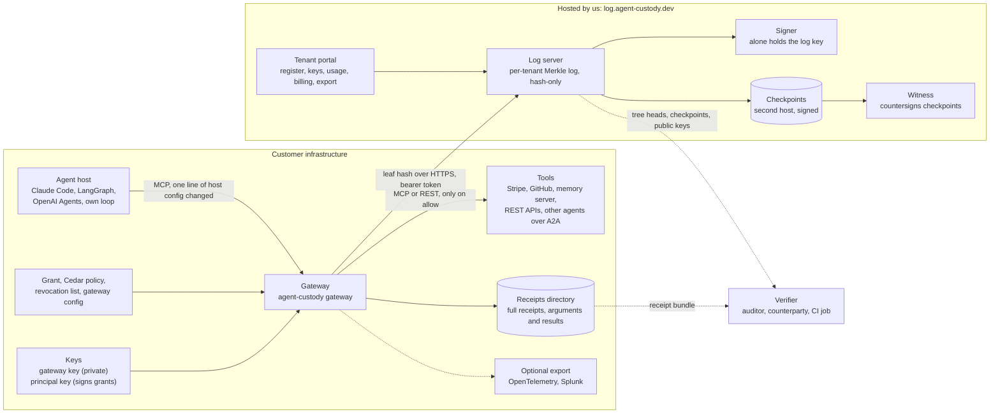
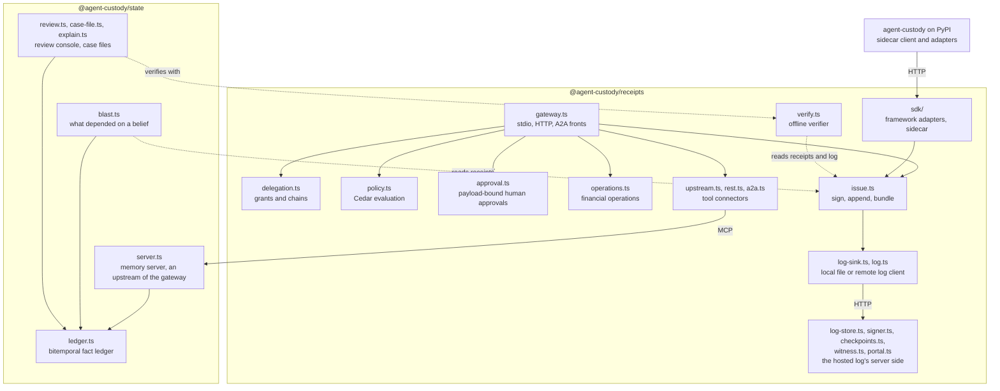
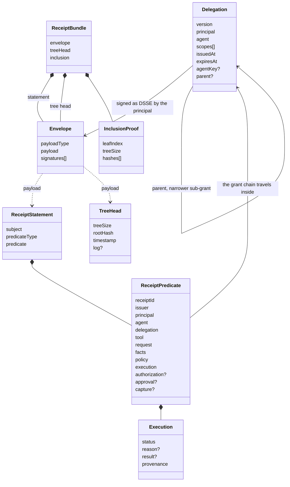
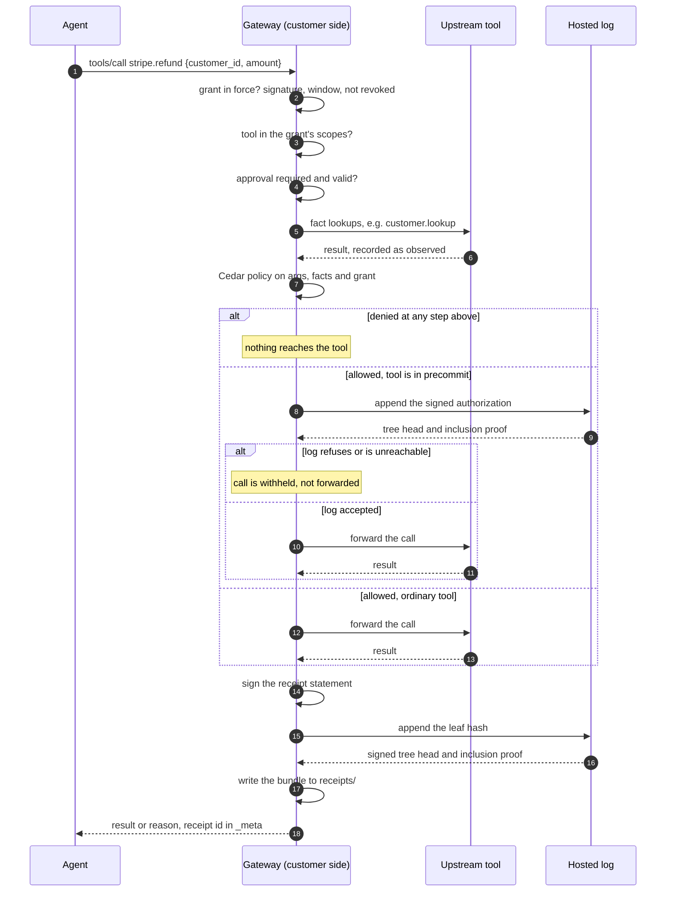
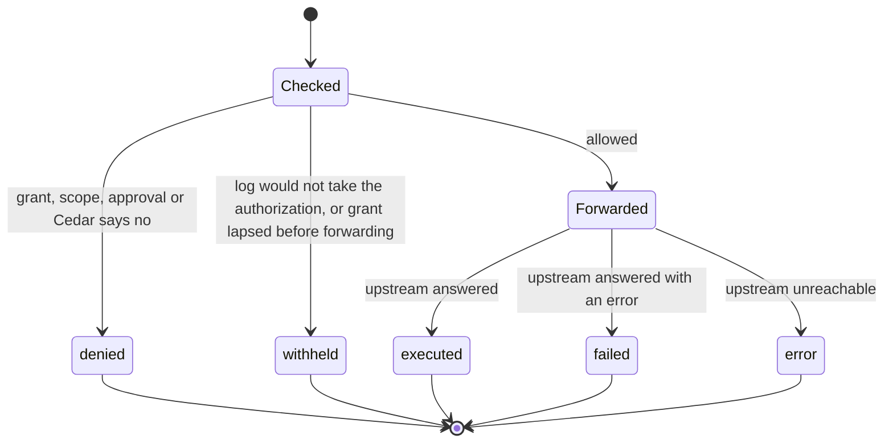
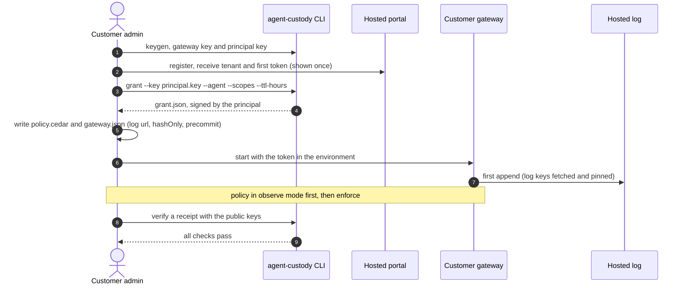
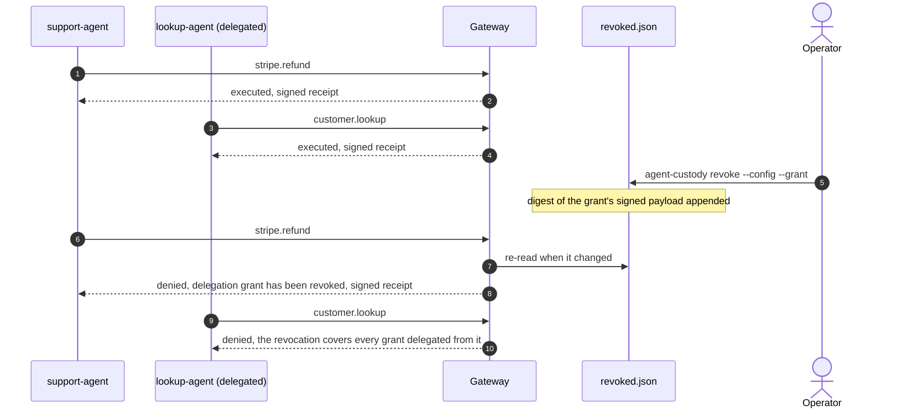
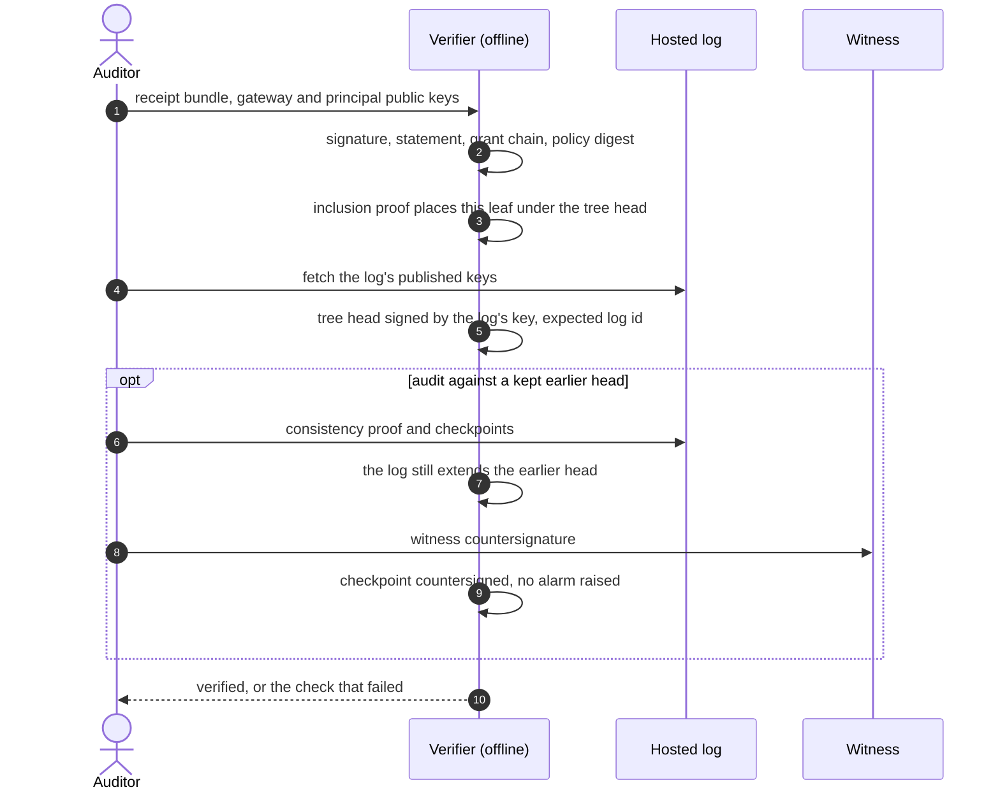

# Architecture

How agent-custody is put together, what runs on the customer's side, what runs on ours, and what changes in the agent. The diagrams are the maps; [Deployment](/guide/deployment) says what each setup proves, and [What each piece is for](/guide/pieces) says when to turn each one on.

## The split in one picture

Almost everything runs in the customer's environment. The one thing a customer cannot run for themselves is a log that is not theirs, so that is the only thing hosted. The hosted log holds hashes, not receipts.

| runs on the customer's side | runs on ours |
| --- | --- |
| the gateway, in front of the tools | the log server for each tenant, at `/t/<tenant>/` |
| the gateway key, the principal key, the grant, the Cedar policy, the revocation list | the signer that holds the log's key, apart from the process facing the internet |
| the tool credentials (Stripe key and the like), held by the gateway, not the agent | signed checkpoints on a second host, and the outside monitor |
| the full receipts, with arguments and results, under the customer's capture rules | the tenant portal: registration, tokens, usage against the plan, billing, export |
| the optional memory server and its ledger | the witness software, which must run on a machine the log's operator does not control; no independent operator runs one for our log yet |

A customer who does not want a hosted log runs the same server from the container, the compose file, or the Kubernetes manifests in `deploy/`.

## What the agent has to change

| agent type | change | what you get |
| --- | --- | --- |
| uses MCP tool servers | name the gateway where the host named the tool server, and remove the direct route | enforcement: a denied call never reaches the tool, and the record is `observed` |
| calls a REST API | describe the endpoints as tools in the gateway config; the credential moves to the gateway | the same, for REST |
| plain function tools | wrap them with the framework adapter, or send them through the sidecar | a record only: every field is `claimed`, because the process describes itself |
| any agent | take tool credentials out of the agent's environment | the gateway cannot be bypassed |

The agent never calls agent-custody. If it holds a credential of its own, nothing here sees what it does with it.

## The pieces and how they depend on each other

## The data model

Every field of the predicate carries a provenance label: `attested` (signed by a key other than the issuer's), `observed` (the gateway obtained it itself), or `claimed` (the agent said so). [The receipts overview](/receipts/) has the full table.

## One tool call

The order is fixed. A denial at any step still produces a signed receipt, and a tool in `precommit` is authorized in the log before it is forwarded.

The status the receipt records is one of five:

## Onboarding a new customer

## Revoking a grant mid-session

Revocation is per grant and takes effect on the next call, with no restart and no key rotation. Editing the Cedar policy is separate and is read when the gateway starts.

## Verifying a receipt without trusting the operator

## What this does and does not cover

- **Only calls through the gateway.** A credential in the agent's environment, a second direct route in the host config, or code that calls an API on its own is outside it. Taking those away is a deployment decision.
- **The SDK and sidecar record, they do not prove.** They run in the process they describe, so their receipts are `claimed`.
- **The hosted log does not see grants or policy.** It sees leaf hashes. A receipt names the grant and carries the policy digest, and a verifier checks both against public keys.
- **The operator can rewrite a local log.** A remote log, published checkpoints, and a witness are what detect that. The witness ships in the package, but a second, independent operator for our log is still being sought, so today the checkpoints are published and the witness step is not yet independent.
- **There is no hosted control plane yet.** Grants, revocation and Cedar policy are managed on the customer's gateway; the portal manages the log, tokens, usage and billing.
- **Policy changes need a restart; grant revocations do not.**
- **Failure mode:** a `precommit` tool is withheld while the log is unreachable. That is deliberate and it is a denial of service on the agent.
- **No transparent egress proxy.** Arbitrary HTTP from agent code is not intercepted.

See [the threat model](/receipts/threat-model) for who could make a receipt false and what stops them, and [the hosted log reference](/reference/hosted) for the log's routes.
